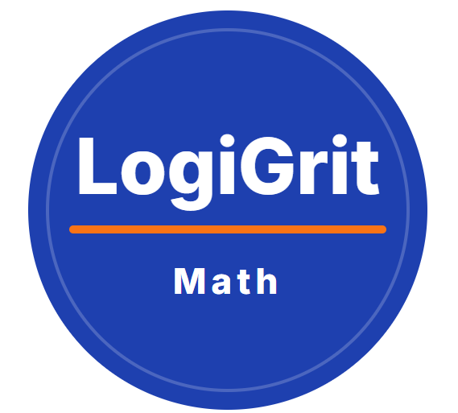

<p align="center">
  
</p>

<h1 align="center">LogiGrit Math</h1>

<p align="center">
  インタラクティブな数学学習ツール
</p>

<h2 align="center">
  四則演算 練習サイト
</h2>

<p align="center">
  小学生向けの無料・四則演算ドリル
</p>

---

## 🌐 サイトURL

https://logigritlab.github.io/math-tools/

---

## 📖 概要

「四則演算ドリル」は、小学生向けの無料計算練習サイトです。

たし算・ひき算・かけ算・わり算の問題をランダムに生成するため、何度でも繰り返し学習できます。

シンプルで使いやすい画面設計により、子どもたちが楽しみながら計算力を身につけられるよう設計されています。

---

## ✨ 特徴

- たし算、ひき算、かけ算、わり算の計算練習が可能
- 1～3けたに対応
- ランダムに問題を生成
- テンキー・キーボード入力対応
- 正解数・不正解数・連続正解数を表示
- スマートフォン・タブレット・PC対応
- 完全無料

---

## 🚀 使い方

1. 演算（たし算・ひき算・かけ算・わり算）を選びます。
2. けた数（1～3けた）を選びます。
3. 表示された問題を解きます。
4. テンキーまたはキーボードで答えを入力します。
5. 「答える」ボタンまたは Enter キーを押します。
6. 正解数・不正解数・連続正解数が自動で記録されます。

---

## 📂 ファイル構成

```text
index.html
README.md

css/
    style.css

js/
    app.js

images/
    logo.png
    
    
    
## 🎯 LogiGrit Mathについて
LogiGrit Math は、子どもから大人まで、世界中の学習者が楽しく数学を学べる教材や学習ツールを制作しています。
計算力だけでなく、
思考力
数学的な考え方
問題解決力
を育てることを目指しています。

## 👤 作者
Hiro
LogiGrit Math